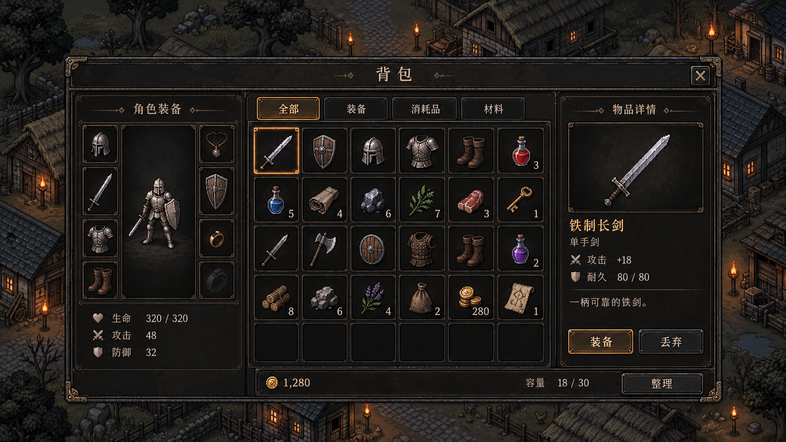

# UI 美术规范

适用于背包、装备、商店、角色属性、任务、弹窗及战斗 HUD 等客户端界面。以已确认的背包效果图作为视觉基准，与[场景美术规范](场景美术规范.md)、[人物美术规范](人物美术规范.md)共同使用。

## 风格参考

[查看原图](参考图/背包UI风格参考.png)。参考图用于确认材质、配色、层次和组件语言；图中的物品数量、容量、属性和布局比例均为效果示例，实际界面应使用真实业务数据，并按目标分辨率适配。

## 整体风格

- 采用暗色中世纪奇幻像素风，气质沉稳、朴素，带有限的使用磨损。
- 以炭黑面板、暗褐皮革、深灰金属和旧铜边框构成界面。以克制的暖金色标记重点，与场景中的火把、窗光呼应。
- 像素边缘清楚，材质通过有限的明暗块面表现；避免柔焦、霓虹光、大面积高饱和色和现代玻璃质感。
- 装饰集中在外框、分区接点和标题两侧，不覆盖操作区域或正文。常用小组件减少装饰，保证信息密度与可读性。
- 主界面、二级弹窗、提示和 HUD 使用同一套颜色与边框语言；表现强度根据功能重要性调整。

## 配色与明度

以下颜色为依据参考图制定的起始色板，并非原图的精确取色。制作时允许围绕材质微调，同类组件保持一致。

| 用途 | 建议色值 | 使用要求 |
| --- | --- | --- |
| 主面板底色 | `#1B1A18` | 炭黑，保留细微纹理，避免大片死黑 |
| 次级区域与物品格 | `#24221E` | 与主面板有足够明度差，方便辨认分区 |
| 次级边框 | `#514638` | 暗褐金属，降低视觉竞争 |
| 外框与装饰 | `#8D7350` | 旧铜色，高光仅用于少量边角 |
| 主文字 | `#D8CCB6` | 暖灰白，用于正文、名称和数值 |
| 次级文字 | `#A79B86` | 用于说明和辅助信息，保持可读 |
| 选中与主要操作 | `#C9954C` | 暖金色，局部使用，避免持续强烈发光 |
| 危险与损失 | `#AD5D50` | 暗红色，搭配文字或图标说明 |
| 正向反馈 | `#82966A` | 灰绿色，用于增加、恢复等状态 |

- 内容区比背景场景更稳定、清楚；打开大型面板时可压暗场景，不能连同 UI 内容一起压暗。
- 重要程度优先通过明度、字号和位置表达，颜色作为辅助。选中、禁用、危险状态不能仅靠色相区分。
- 文字所在区域减少纹理噪点，确保在暗场景和亮场景上均可阅读。

## 面板、布局与组件

- 外层容器使用双层或多层细边框、少量铆钉或角饰；内部分区使用更细、更暗的边线。
- 标题置于独立标题栏，关闭按钮在右上角固定位置。标题、正文、按钮文字的层级在所有界面统一。
- 大型功能界面可采用“角色或分类—内容列表—详情”的布局；简单弹窗按内容精简分区。
- 同一层级组件的边距、间距、对齐方式保持一致。信息不可贴边，文字、图标和数量不得相互覆盖。
- 物品格使用统一尺寸和内边距，空格与占用格边框一致；图标置中，叠加数量放右下角，锁定等状态使用固定角标位置。
- 物品详情的名称、类型、属性、说明和操作按钮按固定顺序组织；长文本可换行或滚动，不压缩到无法阅读。
- HUD 优先保障战斗视野，沿屏幕边缘布局，保持角色、敌人和技能预警区域清楚。
- 提示、确认弹窗和悬浮说明复用相同面板语言；顶层弹窗要有清楚的遮罩与层级。

## 按钮、页签与状态

| 状态 | 视觉表现 |
| --- | --- |
| 默认 | 深色填充、暗铜细框、暖灰文字 |
| 悬停或获得焦点 | 边框略亮，保留清晰焦点标记 |
| 按下 | 填充略暗、内阴影增强，内容位置稳定 |
| 选中 | 暖金细框或局部内沿高光；页签同时改变底色 |
| 禁用 | 降低亮度并提供明确禁用表现，标签仍可辨认 |
| 危险操作 | 暗红强调并写明操作含义，必要时使用确认弹窗 |

- 同一界面只突出当前最主要的操作，普通操作使用低一档的强调程度。
- 选中框、高亮和角标不能遮住物品轮廓或数量。品质边框与选中标记必须能够区分。
- 动效短促、克制，以轻微明暗变化和局部反馈为主，避免大幅缩放、持续闪烁或强光扫过。
- 触屏设备不依赖悬停提供必要信息；按钮视觉尺寸与实际点击区域分别适配。

## 图标与角色展示

- 装备、材料、消耗品使用统一俯视斜角像素画法，匹配人物和场景的像素颗粒、明暗方向与材质表现。
- 金属采用冷灰主体和有限亮边，木材、皮革采用低饱和褐色；药剂可使用少量较鲜明的色块方便分类。
- 同一类图标的主体占格比例与视觉重量一致；狭长武器可以斜放，不能因透明留白过多而显得过小。
- 品质标识使用受控的边框、角标或小色条，同时保留文字说明；避免全格泛光影响物品识别。
- 角色展示遵循人物规范，保留脚底基准和装备遮挡关系；展示背景简洁，不能抢夺装备与属性信息。
- 图标和角色保持透明背景，不将面板底纹、选中框或数量烘焙进图片。

## 字体与文案

- 中文标题可使用具有古朴气质、轮廓清楚的字体；正文和数字优先保证阅读效率，不强求所有文字模拟低分辨率像素。
- 统一标题、分区标题、正文和辅助文字的字号档位；同一用途不随界面任意变化。
- 数字、属性名与单位对齐，数值变化后不挤压布局。长名称、四位以上数量和多行说明需预留空间。
- 文案通过项目本地化系统提供，按钮文字保持可编辑；不得将业务文字直接绘入背景或按钮贴图。实现要求参见[客户端代码规范](客户端代码规范.md)。

## 资源交付与适配

- 交付独立的面板、边框、按钮各状态、页签、格子、图标、角标和装饰素材，附组件预览及使用说明。
- 可伸缩面板使用合理的九宫格切片，保持角饰尺寸与边框粗细；不可将整张效果图作为所有分辨率共用的界面底图。
- 像素素材按目标显示比例制作，优先使用整数倍缩放；导入时核对过滤、压缩、透明边缘和图集留白，防止模糊或串色。
- 字体和像素贴图分别设置合适的采样方式，保证文字清楚和素材边缘稳定。
- 根据横屏、竖屏及目标设备安全区调整布局；保留一致的视觉语言，不直接拉伸整套界面。
- 资源命名应能说明所属模块、组件和状态。参考图与可投入项目的组件资源分别存放，避免将预览图误当正式 UI 资源。

## 验收要求

- 与本页背包参考图并排对比，材质、色调、边框和图标风格一致。
- 在实际游戏尺寸下，名称、属性、数量和主要操作清楚可辨，角色与物品图标没有被底纹淹没。
- 在目标分辨率与安全区下，无拉伸变形、边框失真、文字截断、图标越界或点击区域偏移。
- 检查空背包、满背包、长名称、大数量、禁用按钮与选中物品等状态，信息布局保持稳定。
- 品质、选中、危险和禁用状态可以区分；透明边缘无黑边、白边或图集串色。
